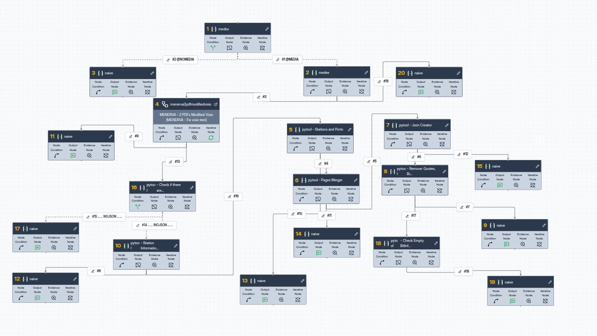
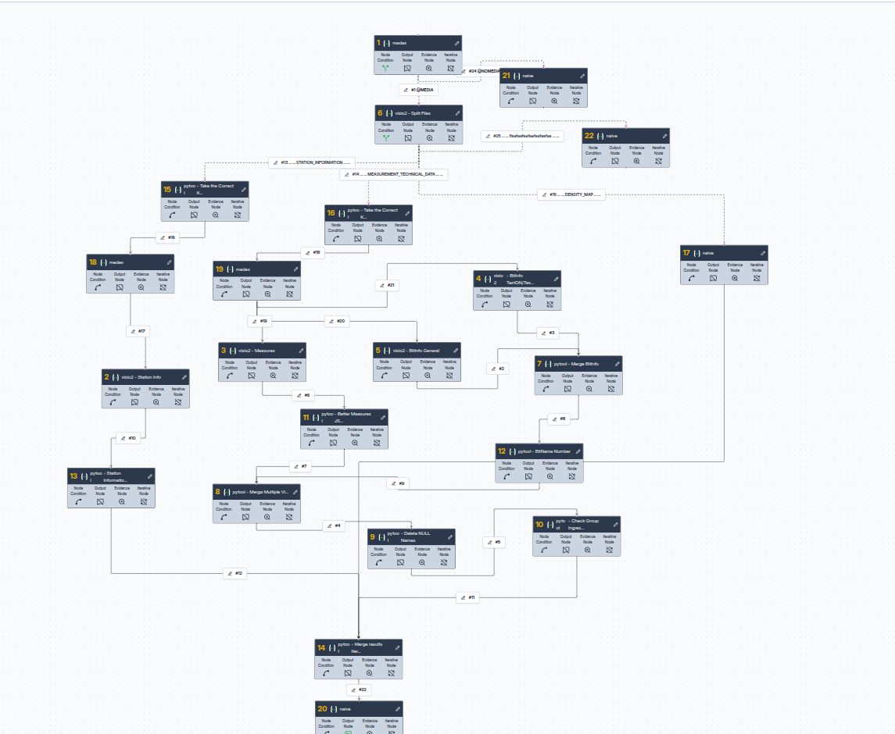

# Architettura — Menerva MAS

## Visione generale

Menerva è un Multi-Agent System (MAS) che automatizza la conversione di documenti tecnici industriali in configurazioni ADAS. Il sistema è ibrido: combina un **VLM (Vision-Language Model)** per l'estrazione di tabelle dai PDF con **moduli Python deterministici** per i calcoli complessi.

## Diagramma dei flussi

### Nodo iterativo

## Principi di progettazione

### 1. Separazione VLM / Python

| Compito | Chi lo fa | Perché |
|---|---|---|
| Leggere tabelle da immagini PDF | VLM (Qwen-VL) | Solo un modello visivo può interpretare layout complessi |
| Calcolare DRIVERPRIVATE hex | Python | Calcolo deterministico, riproducibile |
| Generare XML DRIVERCONFIG | Python | Template-based, nessuna inferenza |
| Rinumerare ID dopo merge | Python | Operazione meccanica, soggetta a errori se fatta da LLM |
| Validare schema JSON | Pydantic | Validazione formale, non euristica |

### 2. Contratti espliciti tra stadi

Ogni stadio della pipeline comunica con il successivo tramite un contratto JSON ben definito:

- **Stadio 4 → Stadio 5**: VLM produce JSON conforme a `docs/contracts/VLM_INTERMEDIATE.md`
- **Stadio 5 → Stadio 6**: Pydantic garantisce che solo JSON valido passa avanti
- **Stadio 6 → Stadio 7**: Formato ADAS conforme a `docs/contracts/ADAS_FINAL.md`

### 3. Gestione degli errori

- Se il VLM produce JSON invalido → Stadio 5 lo rifiuta e chiede re-processing
- Se una misura ha MODBUSREGISTRO null in un contesto non-CALCOLATA → flagged come anomalia
- Se il merge di stazioni fallisce → loggato e isolato, non blocca la pipeline

## Directory structure

Vedi `README.md` principale per la struttura completa.

## Manuali di riferimento

- [Manuale sviluppo linguaggio Manager rev03](Manuale%20sviluppo%20linguaggio%20Manager%20rev03.pdf) — Per la sintassi `VM_SOURCE_CODE`
- [DB Schema](../protocolli/db_config/) — Struttura tabelle ADAS (`bit.txt`, `misure.txt`, `stazione.txt`, `DBinfo.txt`, `driverconfig.txt`)
