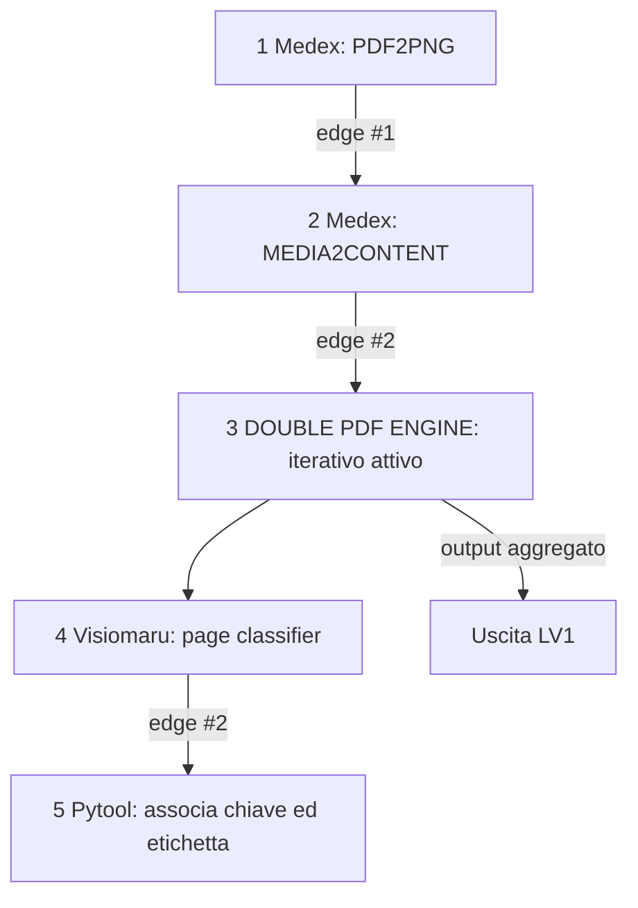
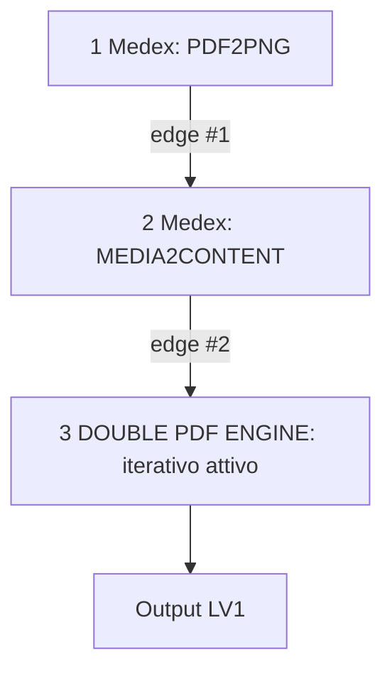
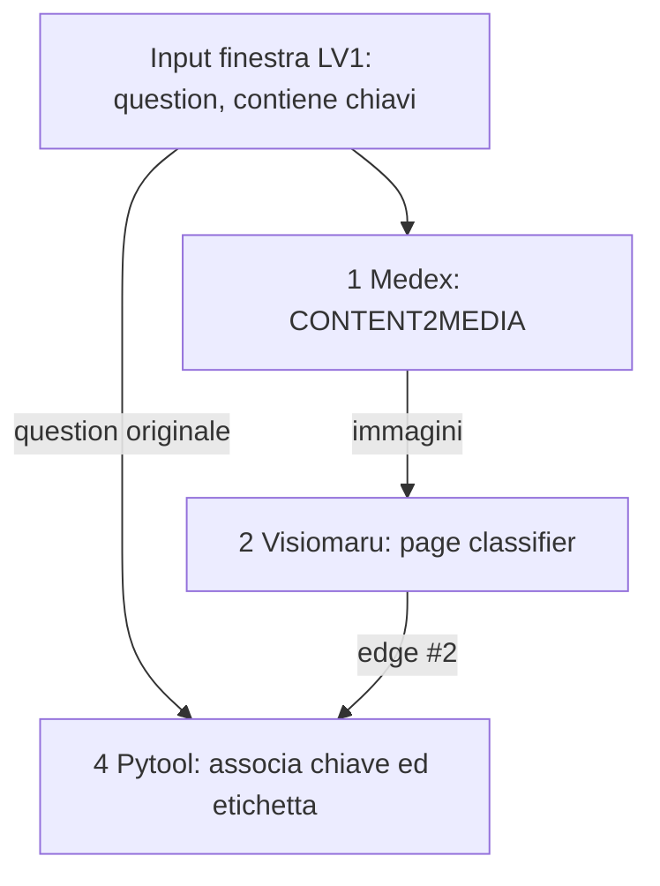

# Double PDF

Riceve in chat i due PDF del caso (IOL + JOB), li converte in media, organizza le pagine in finestre per un Livello 2 iterativo e raccoglie i risultati.

Questo documento riunisce i due livelli in un unico file. Ogni livello ha una sezione propria e le schede dei nodi sono in [`nodes/`](nodes/), con prefisso `lv1_` o `lv2_`.

## Diagramma complessivo



---

# Livello 1

## Scopo

Ricevere insieme in chat i due PDF del caso, convertirne le pagine in media, organizzarle in finestre per il Livello 2 iterativo e raccoglierne i risultati.

## Diagramma osservato



Lo screenshot mostra il flag iterativo attivo sul motore Double PDF. Il nodo interno del motore è descritto in [Livello 2](#livello-2).

## Inventario nodi

| ID | Nodo | Configurazione / compito | Stato |
|---|---|---|---|
| 1 | Medex — PDF TO PNG CONVERSION | `{"request":"pdf2png","nume":5}{question}`. `nume:5` è il fattore di ingrandimento dichiarato dall'utente. | Configurazione osservata; 14 anteprime nel caso 6. |
| 2 | Medex — MEDIA2CONTENT E DIVISIONE IN GRUPPI | `{"request":"media2content","nume":1, "nkeysgrp": 1 }{edge.media}[1]`; produce finestre sovrapposte di chiavi media. | Configurazione e output forniti dall’utente. |
| 3 | DOUBLE PDF ENGINE | Iterativo attivo; riceve l'output del nodo 2. | Attivazione confermata; iterazioni osservate: 14 nel caso 6. |

## Collegamenti

| Edge | Da | A | Dato trasferito |
|---|---|---|---|
| #1 | Nodo 1 | Nodo 2 | Media/pagine convertite |
| #2 | Nodo 2 | Nodo 3 | Finestre di chiavi media |

## Evidenze del caso 6

Gli allegati sono `Mappatura_6_Cliente_SMI_1.pdf` (5 pagine) e `Mappatura_6_Descrizione_Cliente_SMI_1.pdf` (9 pagine). Medex mostra 14 anteprime totali. Il Livello 2 osservato contiene 14 finestre e 14 chiavi media uniche, con una chiave in comune tra finestre adiacenti.

Le chiavi sono identificatori opachi. Prefissi e punto in cui cambiano non sono stabili tra le esecuzioni: una cattura mostrava cardinalità 9+5, la diagnostica più recente 12+2. Non usarli per dedurre confine o nome dei PDF. Il payload non espone filename o numeri pagina.

Le fixture complete del caso sono in [`tests/case_6/`](tests/case_6/).

## Punti da confermare — Livello 1

- Salvare il codice esatto del nodo 2 dal canvas.
- Confermare se il nodo 2 emette sempre finestre di due chiavi con overlap di una, inclusi PDF con una pagina o lunghezze diverse.
- Verificare come il collector LV1 aggrega i risultati del nodo iterativo e conserva gli errori per singola finestra.

---

# Livello 2

## Scopo

Per ogni finestra ricevuta dal motore iterativo, trasformare le chiavi media in immagini, classificare ogni pagina secondo le tre categorie legacy, associare classe e chiave e restituire un record per pagina della finestra.

## Diagramma osservato



## Inventario nodi

| ID | Nodo | Configurazione / compito | Stato |
|---|---|---|---|
| 1 | Medex — `content2media` | `{"request":"content2media","nume":1,"content":{question}}` | Configurazione riportata dall'utente. |
| 2 | Visiomaru — classificatore pagine | Prompt [`prompts/page_classifier_v1.md`](prompts/page_classifier_v1.md). Restituisce JSON `pages` con indici locali. | 14 giri classificati nel test caso 6. |
| 3 | Naive — forwarding | Nodo aggiunto come possibile passaggio delle chiavi. | Edge #4 è risultato vuoto; non è necessario se Pytool legge `{question}`. |
| 4 | Pytool — associa classi alle chiavi | Script [`pytools/associate_page_labels_to_media_keys.py`](pytools/associate_page_labels_to_media_keys.py). | Diagnostica: `{question}` e edge #2 sono JSON validi in tutte le 14 finestre; script corretto pronto per la prova effettiva. |

## Edge del Pytool osservati nello screenshot

| Edge | Sorgente | Significato |
|---|---|---|
| #2 | Nodo Visiomaru | Classificazioni VLM della finestra corrente |
| #3 | Nodo Medex | Payload media passato al nodo Naive |
| #4 | Nodo Naive | Output vuoto nella diagnostica; non usare come sorgente delle chiavi |

Gli indici sono letti dagli edge visibili sul canvas. Prima di incollare lo script, ricontrollare che il canvas non abbia rinumerato i collegamenti.

## Contratto dati del Pytool

Input `{question}`: payload originale ricevuto dal ciclo LV1, potenzialmente con `_medexkeys` contenente JSON serializzato come stringa. Input edge #2: oggetto VLM `{"pages":[{"index":0,"label":"..."}]}`. Gli indici VLM sono locali alla finestra, non globali nel PDF. Il Medex LV2 va usato per fornire le immagini al VLM, non come sorgente delle chiavi da associare.

Output `result`:

```json
{
  "status": "OK",
  "pages": [
    {"key": "<media-key>", "index": 0, "label": "DENSITY_MAP"}
  ]
}
```

Se payload e classificazioni non si possono abbinare, restituisce `status: ERROR` con una diagnosi. Non elimina overlap tra finestre: la deduplicazione deve avvenire dopo il ciclo LV1, usando la chiave media come identità tecnica.

## Punti da confermare — Livello 2

- Confermare l'associazione chiave→pagina con il risultato del Pytool; non inferirla dai prefissi opachi.
- Eseguire lo script aggiornato sul runtime e verificare 14 finestre `OK`: due record per le prime 13, uno per l'ultima.
- Il comportamento dello Pytool quando il numero di chiavi nel payload non coincide con il numero di etichette VLM.
