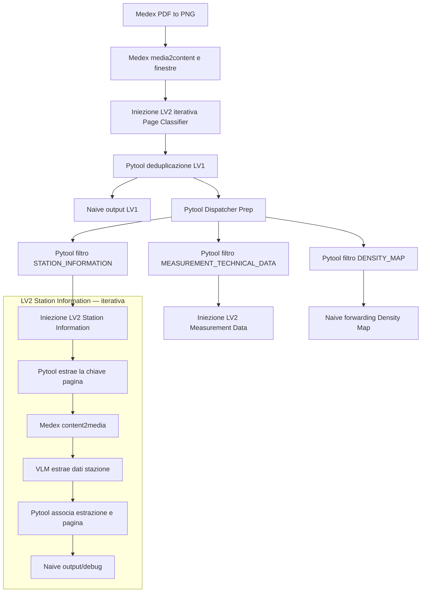

# Workflow Double PDF — stato della progettazione

**Ambito:** nuova implementazione MyHydra in `myhydra/double_pdf/`. Il workflow legacy in `legacy/double_pdf/` resta intatto e viene usato come riferimento funzionale.

## Architettura attuale

MyHydra non espone il nome del PDF di origine e i file caricati possono arrivare in ordine casuale. Il classificatore VLM assegna quindi a ogni pagina sia `document_role` (`IOL`, `JOB` o `UNKNOWN`) sia `label` (tipo pagina). Il routing usa la `label`; il ruolo resta nei metadati per l'elaborazione successiva.

Il diagramma riporta i nodi verificati; lo screenshot conferma il cablaggio della LV2 Measurement con un Pytool, un Medex, tre VLM paralleli, tre Pytool etichettatori e tre Naive distinti. Le Powered identity attuali e gli script aggiornati sono raccolti in [`platforms/lv2/measurement/`](platforms/lv2/measurement/); la nuova configurazione dei campi VLM e i relativi payload sono ancora da verificare a runtime. La sottopiattaforma `PAGE DISPATCHER`, progettata in precedenza per restituire stringhe e attivare rami condizionali, è parcheggiata: i filtri Pytool per etichetta l'hanno resa superflua per la configurazione corrente.

## Stato delle verifiche

| Fase | Evidenza | Stato |
|---|---|---|
| Classificazione e associazione chiave/ruolo/categoria | Run MyHydra dei casi 6 e 7 | Verificata, con avvisi di revisione su alcune categorie |
| Deduplicazione delle finestre sovrapposte | 14 pagine caso 6, 11 pagine caso 7 | Verificata; i conflitti di categoria vengono risolti con priorità legacy e restano negli avvisi |
| Preparazione dell'array root e iterazione LV2 | 14 input `SINGLE_PAGE` nel caso 6 | Verificata in una run diagnostica |
| Filtri e inoltro alle tre destinazioni | Output MyHydra: 6 Station, 7 Measurement, 1 Density nel caso 6 | Verificata in una run; gli indici 1–14 risultano partizionati una sola volta |
| Recupero immagine da chiave nel ramo Station | Medex ha mostrato le sei immagini Station | Verificata per il ramo osservato |
| Estrazione Station e associazione ai metadati | Dopo l'aggiornamento dell'associatore, tutte le 6 pagine terminano senza errori. Dati nelle pagine 6, 7 e 11; `[]` nelle 9, 10 e 12. | Catena tecnica verificata; classificazione e valori da revisionare |
| Estrazione Measurement (3 rami) | Run Qwen 3.8: 69 misure IOL 2–5; ramo bitinfo e ramo stati acquisiti; assemblata per pagina con join su nome | Verificato il 5/10 su tutte le pagine IOL utili |
| Consolidamento LV1 | `CONSOLIDA PRE-JSON CREATOR` cablato (edge diretti #10/#11/#12), run 3.8 `OK`: stazione `Sistema Analisi SO2`, 69 variabili, scale SO2 collegate | Verificato il 5/10; run del 29/10: anche `TF` collegata (`°C`, 0–100) e `limit_hour`/`limit_day` = 60 portati nel chunk |
| Aggregazione e JSON finale | Uscita ADAS caso 6 (run del 29/10) confrontata riga per riga col PDF IOL: 22 misure, 60 bitinfo, registri **40001–40441** (`40000 + REG`), formati `INT`→150 / `REAL`→250, `UNITS mg/Nm3` su SO2, `SQ1HOURMEAN`/`SQDAILYMEAN` = 60 sulle due SO2 | **Verificato il 29/10.** PM-302A/B ai bit 1/2, nessuno scarto, nessuna divisione. Il confronto è contro il PDF, non contro `gaia_doublefile_result_6.json`: il legacy ha 2 registri errati, 18 `bitinfo` fantasma e `TEXTON` shiftati di una riga. Test di verità: `tests/test_adas_caso6_pdf_truth.py` |
| Aggregazione e JSON finale, caso 7 | Run4: **40 misure e 47 bitinfo** (5 stati recuperati col carry-over), 16/18 unità per TAG, REG 166 col nome corretto, sentinel e `UNITS2` confermati | **Verificato il 6/10.** Restano aperti: unità O2 Secco/Umido, 9 fattori `Dividere x10`, nome stazione variabile per run. Test in `myhydra/double_pdf/tests/test_adas_caso7_pdf_truth.py` |
| Script del nodo 12 | Copia canvas `json_creator_edge13_canvas.py` (29.552 byte, sha256 `3c6c3b43…`) AST-identica al file documentato, con test di parità e soglia 32 KB | ✅ **Chiuso il 29/10**: offset 40000, limiti in `SQ*`, guardia non numerici. Nessun output Double è ancora stato importato in un ADAS reale |
| Tabelle senza colonna REG | Prompt misure **v7**: una mappa DB50/DB10x senza REG non produce misure, `MODBUSREGISTRO` mai ricavato da `DBX`/`DBW`/`DBD` | **Pronto il 29/10**, da incollare nel nodo `ESTRAI MISURE E BISON`; verifica attesa sulla run Essity (3 misure inventate da eliminare) |

Le esecuzioni MyHydra possono restituire classificazioni diverse tra run sulle pagine di confine. I fixture anonimizzati conservano risultati distinti; un risultato osservato non va trattato come ground truth se ha `review_required: true`. Il `sequence_index` è posizionale nell'ordine di ricezione (gli upload arrivano in ordine casuale e il Medex decide il parsing): non identifica la pagina fisica tra run diverse. Per selezionare pagine in modo stabile usare `document_role` + `label`, mai l'indice.

## Contratti dei passaggi LV1

1. Il classificatore produce record con chiave media, `sequence_index`, `document_role` e `label`.
2. Il deduplicatore LV1 collassa solo la stessa chiave media ripetuta dalle finestre sovrapposte. Non unisce pagine o dati semanticamente simili.
3. Il preparatore restituisce l'array root di record pagina, propagando `review_required` e `review_warnings`.
4. I filtri sono Pytool non iterativi e conservano il record intero. Leggono rispettivamente gli edge di input #5 (Station), #7 (Measurement) e #6 (Density), secondo la configurazione documentata al momento dell'ultima prova. Gli indici edge sono locali al canvas: ricontrollarli se si modificano i collegamenti.
5. Le due iniezioni LV2 classificazione/estrazione iterano sulle pagine del rispettivo filtro. Il forwarding Density Map non trasforma il record.

Gli script e i prompt sono organizzati per sottopiattaforma in [`platforms/`](platforms/); i collegamenti e le impostazioni dei nodi sono raccolti in [`nodes/`](nodes/).

## Contratto corrente LV2 Station Information

Il contesto iterativo `{question}` porta il record pagina originale e la sua chiave. Il Pytool estrae la chiave; Medex `content2media` la risolve in immagine. Nel VLM inserire `{edge.media}[n]` da solo nel campo **Prompt** (indice dell'edge Medex→VLM), lasciare **Context** vuoto e mettere le istruzioni nel **Powered identity**. Non incorporare il token media nelle istruzioni. Il Pytool finale associa l'array JSON VLM al record pagina e preserva ruolo, etichetta, sequenza e avvisi.

Il VLM lavora sulla singola immagine della pagina corrente. Il token media va nel campo **Prompt**, le istruzioni nel **Powered identity**, e **Context** resta vuoto. Se la pagina non contiene informazioni Station, il prompt richiede `[]`; se un campo non è presente, non va inventato. Il valore predefinito legacy `SME` non deve essere sintetizzato in ogni singola pagina: eventuale normalizzazione si decide nel consolidamento. La scheda completa è in [`nodes/lv2_05_station_information_extraction.md`](nodes/lv2_05_station_information_extraction.md). La v2 è stata eseguita prima di separare i campi; configurazione e prompt correnti sono in [`platforms/lv2/station_information/`](platforms/lv2/station_information/), ancora da riverificare.

**Esito della v2:** nel primo output, pagina 9 aveva un payload non-array e pagina 12 un oggetto vuoto. L'associatore aggiornato gestisce array, oggetto singolo o `null` e scarta oggetti senza valori. Nella run successiva tutte le sei iterazioni hanno prodotto un record associato senza `ERROR`: dati nelle pagine 6, 7 e 11; `station_info: []` nelle pagine 9, 10 e 12. Il risultato della pagina 10 varia tra run (prima conteneva il nome, poi `[]`), perciò controllare l'immagine prima di consolidare quel campo. In questa run gli avvisi di classificazione sono alle pagine 11 e 12; mantenerli separati dai dati VLM. Fixture prima run: `tests/case_6/outputs/observed_lv2_station_information_v2_sanitized.json`; run successiva: `tests/case_6/outputs/observed_lv2_station_information_v2_associated_sanitized.json`.

I campi recuperati sono distribuiti tra pagine: pagina 6 contiene protocollo, IP e porta PLC; pagina 7 contiene due intervalli `campi_scala` (SO2 e Temperatura fumi). L'assenza degli altri campi in quei record non va completata con inferenze locali: l'associazione/aggregazione fra pagine va progettata in seguito.

Nell'output MyHydra `review_required` appare come numero (`0`/`1`) e `review_warnings` come stringa JSON (`"[ ]"` o array serializzato), mentre `station_info` è un array JSON. Registrare questa differenza di tipo e normalizzare i metadati in un Pytool deterministico prima dell'aggregazione/final output.

## Prossime fasi

1. **Prova di importazione in ADAS reale.** Mai fatta: finora la validazione è contro PDF e
   contratto JSON. È l'unica verifica che manca alla catena.
2. **Prompt misure v7 nel canvas.** Incollare `measurement_measures_bison_v7.md` nel Powered
   identity del nodo `ESTRAI MISURE E BISON` (Prompt `{edge.media}[1]`, Context vuoto) e rifare la
   run Essity: le 3 misure inventate dai DBD 160/168/192 devono sparire.
3. **Fattori `Dividere x10`** delle 9 misure asteriscate (JOB 4.5.2, colonna RANGE IOL): il chunk
   non li porta ancora, quindi `Division` resta `false`.
4. **Unità O2 Secco/Umido** (caso 7): le uniche 2 scale non collegate; indagare sul chunk della run4.
5. **Nome stazione variabile per run** (`Sistema Analisi Emissioni` vs `SME`): il ramo Station a
   volte restituisce `null`. Da chiarire col cliente insieme a BISON, zeri iniziali e regola V2.
6. Terza coppia IOL+JOB mai vista, prima di allargare le conclusioni di qualità.
7. Conservare i warning sulle pagine Station 11 e 12 e normalizzare `review_required`/`review_warnings` in modo esplicito prima dell'aggregazione.

## Elementi parcheggiati

- La piattaforma `PAGE DISPATCHER` e gli script `dispatch_classified_pages.py` e `diagnose_dispatch_injection.py` sono rimasti nel progetto come materiale diagnostico/storico. Non fanno parte del percorso LV1 corrente.
- Non eliminare la piattaforma MyHydra `PAGE DISPATCHER` finché non è completata la verifica dei rami attuali e l'utente non dà l'indicazione concordata.
- Non modificare il legacy durante gli aggiornamenti del progetto nuovo.
