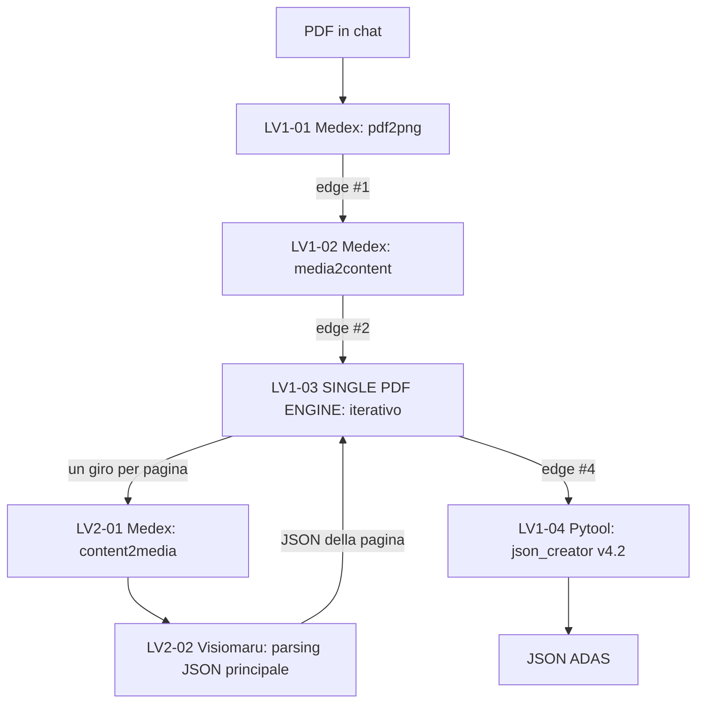

# Single PDF

Riceve **un solo PDF** di mappatura PLC/SCADA e produce il JSON per la piattaforma ADAS. È il flusso storico del progetto ed è quello che il modello corrente rende completo.

## Flusso



Il Livello 2 **termina al VLM**. Ogni giro ritorna un JSON di pagina al motore, che lo accumula; il pytool finale unisce tutto e trasforma. Questa è la modifica strutturale dell'Opzione B di ADR-001, che ha sostituito i tre nodi di merge interni del legacy con un unico pytool a valle.

## Il principio che governa il progetto

**Il VLM legge, Python calcola.**

| Compito | Chi lo fa | Perché |
|---|---|---|
| Interpretare una tabella in un'immagine | VLM | Solo un modello visivo può leggere un layout complesso |
| Dedurre la tipologia di una variabile | VLM con regole esplicite | Serve giudizio sul contenuto |
| Calcolare `DRIVERPRIVATE` | Python | Calcolo deterministico, deve essere riproducibile |
| Generare l'XML `DRIVERCONFIG` | Python | Template, nessuna inferenza |
| Unire le pagine, rinumerare gli ID | Python | Operazione meccanica, soggetta a errore se affidata a un LLM |
| Validare lo schema | Pydantic | Validazione formale, non euristica |

Il prompt vieta al VLM di calcolare `ID`, `DRIVERDATA`, `TYPE`, `DRIVERPRIVATE` e l'XML. Se il modello lo facesse, i valori non sarebbero riproducibili e il pytool non potrebbe fidarsene.

## Inventario nodi

| ID | Nodo | Configurazione / compito | Stato |
|---|---|---|---|
| [LV1-01](nodes/lv1_01_pdf2png.md) | Medex — PDF2PNG | `{"request":"pdf2png","nume":3}{question}` | Configurazione nota dal legacy. |
| [LV1-02](nodes/lv1_02_media2content.md) | Medex — MEDIA2CONTENT | `{"request":"media2content","nume":0, "nkeysgrp": 1}{edge.media}[1]` | Configurazione nota dal legacy. |
| [LV1-03](nodes/lv1_03_single_pdf_engine.md) | SINGLE PDF ENGINE | Iterativo, un giro per pagina | Aggregazione mai verificata su dati reali. |
| [LV1-04](nodes/lv1_04_json_creator.md) | Pytool — JSON CREATOR | [`json_creator.py` v4.2](pytools/json_creator_v4_2.py), 667 righe | Implementato e testato. |
| [LV2-01](nodes/lv2_01_content2media.md) | Medex — CONTENT2MEDIA | `{"request":"content2media","content":{question}}` | Configurazione nota dal legacy. |
| [LV2-02](nodes/lv2_02_vlm_parsing_json_principale.md) | Visiomaru — parsing JSON | [prompt `v13`](prompt/vlm_extraction_v13.md) | Prompt in uso. |

### Nodi in backlog

Non fanno parte della catena. Elencati in `TODO.md` e tenuti tracciati per il giorno in cui verranno costruiti.

| Nodo | Perché è in backlog |
|---|---|
| [pdf_splitter](nodes/backlog_01_pdf_splitter.md) | Il compito è già svolto implicitamente da `pdf2png` più `media2content` con `nkeysgrp: 1`. |
| [page_classifier](nodes/backlog_02_page_classifier.md) | Serve al Double PDF, dove le pagine sono di tipo diverso. Nel Single PDF tutte si trattano allo stesso modo. |
| [merge_pages](nodes/backlog_03_merge_pages.md) | Il merge è incorporato in `json_creator.py`. Separarlo significherebbe rinumerare ID su dati già trasformati. |

## Contratto dati fra i due livelli

Il Livello 2 produce, per ogni pagina, un JSON di questa forma:

```json
{
  "stations": [{
    "name": "string | null",
    "protocol": "string | null",
    "ip": "string | null",
    "port": 502,
    "modbus_id": 1,
    "variables": [{
      "description": "string",
      "units": "string | null",
      "modbus_register": 40001,
      "bit": 3,
      "kind": "ANALOGICA | DIGITALE_SINGOLO | DIGITALE_IMPACCATO",
      "data_type": "string | null",
      "read_write": "R | W | null",
      "state_on": "string | null",
      "state_off": "string | null",
      "scale_elec_start": 0, "scale_elec_end": 0,
      "scale_eng_start": 0, "scale_eng_end": 0,
      "limit_hour": 0, "limit_day": 0
    }]
  }]
}
```

Il pytool riceve i JSON di tutte le pagine aggregati dal motore e ne produce **uno** in formato ADAS. Per i dettagli dei formati d'ingresso accettati, vedi la [scheda del pytool](nodes/lv1_04_json_creator.md).

## Regole di gestione delle stazioni

Sono la parte del dominio che ha il maggiore impatto sull'output e che è stata verificata sui PDF reali.

| Situazione | Comportamento |
|---|---|
| Stesso IP reale su pagine diverse | **Unite** in una stazione unica |
| IP placeholder (`xxx.xxx.xxx.xxx`, `xxx,xxx,xxx,xxx`, `:`) | **Mai unite**, né fra loro né con IP reali: stazioni sempre separate |
| IP reali diversi | Sempre separate |
| IP assente | Separate, con fallback a `127.0.0.1` e warning nell'output |
| Nome assente | Fallback `"SME"` |
| Più IP reali sulla stessa pagina | Una stazione per IP |

Il caso dei placeholder è la regola più controintuitiva e va ricordata: due pagine con lo stesso IP placeholder **non** sono la stessa stazione, anche se tutto il resto coincide.

## Test

[`test/`](test/) contiene il caso PROTEC_1, l'unico con una fixture VLM intermedia reale. Il confronto con il ground truth legacy è stato eseguito e le divergenze sono documentate in [`test/caso_2_protec_1/README.md`](test/caso_2_protec_1/README.md).

Due avvertenze che condizionano la lettura di quel test: le fixture contengono dati di produzione presi alla lettera, e il run osservato ha passato il fixture come un unico chunk, quindi **non** ha esercitato il percorso di merge multi-pagina.

## Stato e rischi

**Fatto.** Prompt v13, pytool v4.2, validazione Pydantic dello schema intermedio, 15 test automatici tutti superati.

**Rischio 1, aggregazione.** Il modo in cui il motore iterativo aggrega i JSON delle pagine non è mai stato verificato su un PDF reale. Il parser del pytool è difensivo proprio per questo, ma è una difesa, non una verifica.

**Rischio 2, indice edge.** Il placeholder `{edge}[4]` è fragile: cambia se il numero di nodi precedenti il pytool varia.

**Rischio 3, pagine di indice.** Alcuni PDF hanno pagine di indice delle mappe registri, con intestazioni come `Parametri` o `Comandi digitali`, che non sono variabili reali.

**Bloccato.** BISON e linearizzazione. `VM_SOURCE_CODE` resta hardcoded a un valore di default e i campi `scale_*` e `limit_*` sono raccolti dal VLM ma mai usati dallo script.

**Non eseguito.** La verifica sulla piattaforma MyHydra. Nessun nodo di questo flusso è stato osservato in esecuzione con il prompt v13.

## Un altro flusso esiste

La piattaforma cloud mostrava, al 28/09/2026, una topologia **diversa** da questa: sei nodi al Livello 1, rami `@MEDIA` e `@NOMEDIA`, e un pytool descritto come "Pulizia JSON PRE-BISON". Non è implementata in questo repository e non si sa se sia una versione più recente o un ramo separato. È raccolta in [`flusso_cloud_osservato.md`](flusso_cloud_osservato.md), separata di proposito da questa pagina.

## Documentazione correlata

- [ADR-001, merge multi-pagina](../../docs/architettura/ADR-001-merge-multi-page.md) — la decisione che ha definito questa architettura
- [Contratto VLM](../../docs/contracts/VLM_INTERMEDIATE.md) *(dichiara ancora v11 come riferimento)*
- [Contratto ADAS](../../docs/contracts/ADAS_FINAL.md) *(diverge dal codice su `DRIVERPRIVATE` e sul trattamento dei placeholder)*
- [Double PDF](../double_pdf/README.md) — l'altro flusso, su coppie di PDF
- `legacy/single_pdf/` — le esportazioni testuali dei nodi del vecchio MAS, da non modificare
