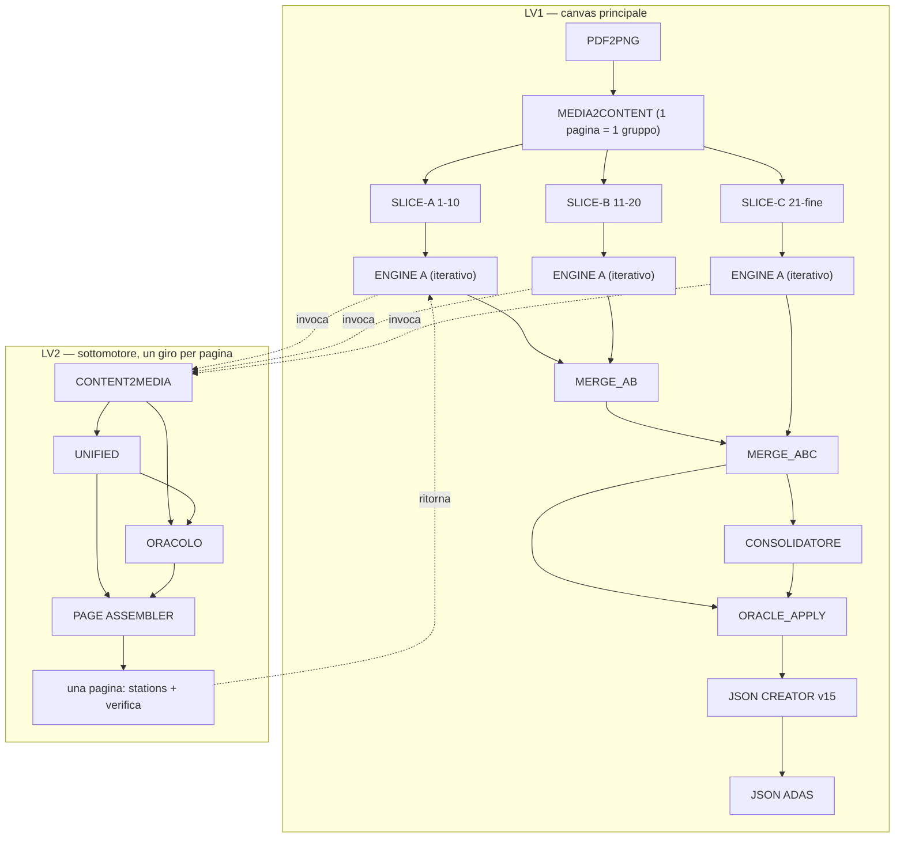

# Single PDF — redesign v2

Un PDF di mappatura PLC/SCADA → **JSON ADAS**. È il flusso completo del
progetto: estrazione VLM a pagina singola, verifica con un secondo VLM,
consolidamento deterministico.

## Stato (4 novembre 2026)

- **Progettazione chiusa.** Due prompt (`UNIFIED`, `ORACOLO`), due pytool nuovi
  (`PAGE ASSEMBLER`, `ORACLE_APPLY`), creator v15 con audit dell'oracolo.
- **Canvas cablato** (LV1: 16 nodi, LV2: 5 nodi). Prima run di collaudo:
  PROTEC_2.
- **Suite verde:** 251 test root + 84 Double; copie canvas tutte sotto il
  budget di paste (34.113 byte la più grande).
- **Non ancora fatto:** importazione in ADAS reale; decisioni cliente su BISON,
  zeri iniziali, regola V2, nome stazione.

## Mappa della directory

Fuori da `archive/` c'è **solo materiale che si incolla o si esegue oggi**.

| Percorso | Cosa contiene |
|---|---|
| [`prompt/`](prompt/README.md) | i **due** prompt correnti: `vlm_unified_v1.md`, `vlm_oracle_v1.md` |
| [`pytools/`](pytools/README.md) | i 6 script correnti, ognuno in coppia documentato + canvas (paste) |
| [`nodes/`](nodes/README.md) | una scheda per nodo (LV1 + LV2) |
| [`platforms/`](platforms/README.md) | documenti di cablaggio canvas: LV1, LV2, checklist edge |
| [`verifica_pdf/`](verifica_pdf/README.md) | verità PDF per caso e confronti |
| [`pdf_input/`](pdf_input/README.md) | gli 8 PDF di riferimento |
| [`archive/`](archive/README.md) | **versione precedente** (3 rami v13–v19, creator v4.x, run di ottobre): solo riferimento |
| `TESTS/` | artefatti delle run (ignorata da git) |

Lo stesso prompt vive in due posti: `src/prompts/` (autorevole) e
`myhydra/single_pdf/prompt/` (copia di paste, byte-identica). I prompt storici
vivono **solo** in `src/prompts/archive/`.

## Flusso



## Il principio

**Il VLM legge, Python calcola.**

| Compito | Chi |
|---|---|
| Leggere una tabella da un'immagine | `UNIFIED` |
| Segnalare le discrepanze con evidenza | `ORACOLO` |
| Applicare (o rifiutare) le correzioni | `ORACLE_APPLY` |
| Unire pagine, fondere stazioni, numerare gli ID | `CONSOLIDATORE` + `JSON CREATOR` |
| Calcolare `DRIVERPRIVATE`, XML, sentinel | `JSON CREATOR` |

L'oracolo **non riscrive mai** `stations`: aggiunge o annulla campi con un
audit trail (`_audit_oracolo`) che finisce nel `_meta` del FINALE.

## Contratto di pagina (LV2 → LV1)

```json
{
  "page_no": 3,
  "stations": [{
    "name": "string | null",
    "protocol": "string | null",
    "ip": "string | null",
    "port": 502,
    "modbus_id": 1,
    "variables": [{
      "description": "string",
      "units": "string | null",
      "modbus_register": 40001,
      "bit": 3,
      "kind": "ANALOGICA | DIGITALE_SINGOLO | DIGITALE_IMPACCATO",
      "data_type": "string | null",
      "read_write": "R | W | null",
      "state_on": "string | null",
      "state_off": "string | null",
      "scale_elec_start": 0, "scale_elec_end": 0,
      "scale_eng_start": 0, "scale_eng_end": 0,
      "limit_hour": 0, "limit_day": 0
    }]
  }],
  "verifica": {
    "mancanti": [], "unita_inventate": [], "junk_stati": [],
    "refusi_corretti": [], "ip_dichiarati_non_usati": []
  },
  "assemble_warnings": []
}
```

`verifica` e `assemble_warnings` sono la novità v2: viaggiano con la pagina
fino a `ORACLE_APPLY`, che li trasforma in warning nel tap (`oracolo_*`,
`oracolo_assente`, `oracolo_input_assente`).

## Regole di gestione delle stazioni

| Situazione | Comportamento |
|---|---|
| Stesso IP reale su pagine diverse | **Unite** in una stazione unica |
| IP placeholder (`xxx.xxx.xxx.xxx`, `:`) | **Mai unite**: stazioni separate |
| IP reali diversi | Separate |
| IP assente | Separate, fallback `127.0.0.1` + warning (`_meta`) |
| Nome assente | Fallback `"SME"` |
| Più IP reali sulla stessa pagina | Una stazione per IP |

## Cosa si incolla nel canvas

| Nodo | File | Edge (da rileggere) |
|---|---|---|
| `UNIFIED` | `prompt/vlm_unified_v1.md` in Powered identity | `{edge.media}[N]`, Context vuoto |
| `ORACOLO` | `prompt/vlm_oracle_v1.md` in Powered identity | `{edge.media}[N]`, Context = `{edge}[M]` di UNIFIED |
| `PAGE ASSEMBLER` | `pytools/page_assembler_canvas.py` | `raw_u`, `raw_o` |
| `SLICE-A/B/C` | `pytools/slicer_canvas.py` | `raw`, con `START`/`END` per shard |
| `MERGE_AB`, `MERGE_ABC` | `pytools/merger_canvas.py` | `raw_a`, `raw_b` |
| `CONSOLIDATORE` | `pytools/consolidator_canvas.py` | `raw` |
| `ORACLE_APPLY` | `pytools/oracle_apply_canvas.py` | `raw_c`, `raw_v` |
| `JSON CREATOR` | `pytools/json_creator_v15_canvas.py` | `raw` |

Gli indici sono locali al canvas: **rileggerli a ogni rewiring**. Un indice
sbagliato non dà errore, dà un nodo blank. Checklist completa in
[`platforms/README.md`](platforms/README.md).

## Verifica di una run

1. `SLICE-A/B/C`: numero di gruppi atteso (shard fuori portata → `[]`, non è un guasto).
2. `CONSOLIDATORE`: `stations`, `warnings`, `counters` — mai blank.
3. `ORACLE_APPLY`: warning `oracolo_*`; `oracolo_assente`/`oracolo_input_assente` = oracolo non collegato o Context vuoto.
4. `JSON CREATOR`: `_meta.audit_oracolo`, `_meta.variabili_toccate_dall_oracolo`, `_warnings`.
5. Confronto con la verità PDF del caso in [`verifica_pdf/per_caso/`](verifica_pdf/per_caso/).

Gate completo: [`verifica_pdf/BENCHMARK_GATE.md`](verifica_pdf/BENCHMARK_GATE.md) (§13-bis).

## Rischi aperti

1. **Aggregazione del motore** mai verificata su PDF reale (ADR-001): il
   consolidatore è difensivo, ma è una difesa, non una prova.
2. **IP fabbricato** (`127.0.0.1`) quando la pagina non dichiara un IP.
3. **Nome stazione** variabile (`Sistema Analisi Emissioni` vs `SME`).
4. **BISON / linearizzazione** bloccati in attesa del cliente.

## Documentazione correlata

- [ADR-001, merge multi-pagina](../../docs/architettura/ADR-001-merge-multi-page.md)
- [Riorganizzazione della directory](../../docs/architettura/RIORGANIZZAZIONE_2026-11-04.md)
- [Contratto VLM](../../docs/contracts/VLM_INTERMEDIATE.md)
- [Contratto ADAS](../../docs/contracts/ADAS_FINAL.md)
- [Double PDF](../double_pdf/README.md)
- [`legacy/single_pdf/`](../../legacy/single_pdf/) — esportazioni del vecchio MAS, read-only
